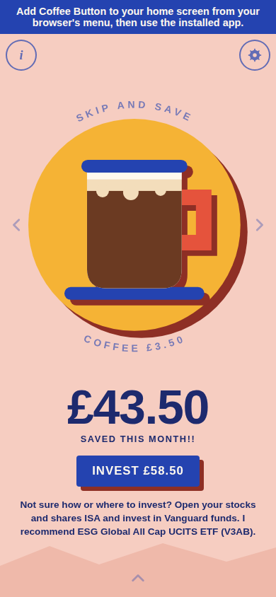
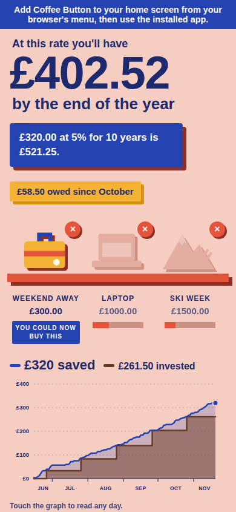

# Coffee Button

A Home Screen web app that is just a coffee cup. Tap it when you skip buying a
coffee: a two-second ceremony plays and the coffee's price goes on a ledger you
clear into your Stocks and Shares ISA once a month.

<p>
  
  
</p>

The screenshots use made-up data (`.scratch/coffee-button/test-data/`).

## What this repository is

A showcase, not a product. I built it for myself and a few friends to try, and
I am publishing it as a record of how it was built rather than as an app to
install. The interesting part is the process, and all of it is in the
repository:

- **A design agreed before any code.** `docs/DESIGN.md` was written after a
  questioning session on 3 November 2026 and has been kept current since, with
  each later decision dated and tied to its ticket.
- **Small tickets with acceptance boxes.** All 39 are in
  `.scratch/coffee-button/issues/`, with the screenshots taken to check them in
  `.scratch/coffee-button/shots/`.
- **Test-first, at agreed seams.** 394 Vitest tests. The rules live in
  `src/domain` as pure functions with a test beside every module; each device
  (clock, clipboard, audio, haptics, timers, storage) sits behind one interface
  with a real implementation and a fake. The DOM glue in `src/ui` is not unit
  tested, by decision; it is checked by screenshot and on a phone.
- **Built with AI coding agents under written rules.** `CLAUDE.md` is the
  rulebook the agents worked to, and `docs/HANDOFF.md` is the running state one
  session leaves for the next. The commits carry a `Co-Authored-By` line for
  the model that wrote them.
- **Feedback rounds from real testers**, triaged into tickets and built: see
  the dated entries at the top of `docs/HANDOFF.md`.

It also talks to a real bank: with a Starling personal access token, each press
moves the coffee's price into a savings Space, through a small relay
(`relay-worker/`) because Starling's API sends no CORS headers. The token stays
on the phone and is never exported.

## Install on your iPhone

1. Open the app link you were sent in Safari. (The app is hosted on
   Cloudflare; its address is not written in this repository.)
2. Tap Share, then Add to Home Screen.
3. Open Coffee Button from the Home Screen icon.

Use the installed app, not the Safari tab: the app keeps your data only when it
is installed on the Home Screen.

## Link Starling

1. In the app, open Settings and find the Starling section.
2. At <https://developer.starlingbank.com> create a Personal Access Token with
   these four scopes: `account:read`, `savings-goal:read`,
   `savings-goal:create`, `savings-goal-transfer:create`.
3. Paste the token, tap Connect, then pick a Space (or create a Coffee Button
   Space).

The token stays on your phone only.

## Run your own relay

Starling's API sends no CORS headers, so the app talks to it through a small
relay. The hosted app uses a Cloudflare Worker (`relay-worker/`, deployed with
the app by `scripts/cf-deploy.sh`). To run your own, deploy that Worker or
serve `node scripts/relay.mjs` behind HTTPS, then set the Relay URL in the
app's Settings to its address.

## Read next

`docs/DESIGN.md` is the agreed design and the reasons behind it.
`docs/HANDOFF.md` is the current state and what is still open. `CLAUDE.md`
describes how the code is laid out and the rules it is built under.

## Develop

```sh
npm ci
npm test
npm run dev
```

`BASE_PATH=/coffee-button/ npm run build` builds for the GitHub Pages sub-path;
without it the build serves from `/`.
